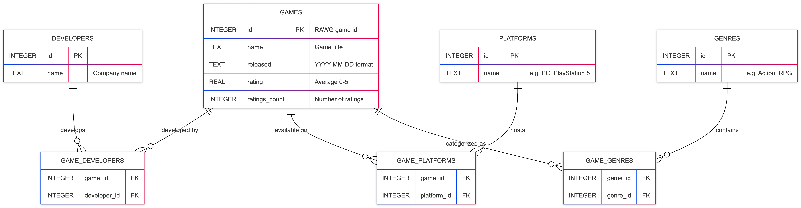

# Database Schema

The GameFinder database is a video game management system built on data from [RAWG](https://rawg.io/). It contains 9 tables with information about games, developers, platforms, genres, players, and user reviews.

## Tables Overview



> ERD diagram generated using [mermaid-js](https://mermaid-js.github.io/mermaid/#/entityRelationshipDiagram)

### Primary Tables

| Table      | Records | Purpose                                        |
| ---------- | ------- | ---------------------------------------------- |
| GAMES      | 2,000   | Core game information from RAWG                |
| DEVELOPERS | 2,020   | Game developers/publishers                     |
| PLATFORMS  | 44      | Gaming platforms (e.g., PC, PlayStation, Xbox) |
| GENRES     | 19      | Game genres (e.g., Action, RPG, Strategy)      |

### Junction Tables (Many-to-Many)

| Table           | Records | Purpose                            |
| --------------- | ------- | ---------------------------------- |
| GAME_DEVELOPERS | 2,920   | Links games to their developers    |
| GAME_PLATFORMS  | 5,534   | Links games to available platforms |
| GAME_GENRES     | 5,044   | Links games to their genres        |

## Schema

```sql
CREATE TABLE IF NOT EXISTS GAMES (
    id             INTEGER PRIMARY KEY,
    name           TEXT    NOT NULL,
    released       TEXT,
    rating         REAL,
    ratings_count  INTEGER
);

CREATE TABLE IF NOT EXISTS DEVELOPERS (
    id   INTEGER PRIMARY KEY,
    name TEXT NOT NULL
);

CREATE TABLE IF NOT EXISTS PLATFORMS (
    id   INTEGER PRIMARY KEY,
    name TEXT NOT NULL
);

CREATE TABLE IF NOT EXISTS GENRES (
    id   INTEGER PRIMARY KEY,
    name TEXT NOT NULL
);

CREATE TABLE IF NOT EXISTS GAME_DEVELOPERS (
    game_id      INTEGER NOT NULL,
    developer_id INTEGER NOT NULL,
    PRIMARY KEY (game_id, developer_id),
    FOREIGN KEY (game_id) REFERENCES GAMES(id),
    FOREIGN KEY (developer_id) REFERENCES DEVELOPERS(id)
);

CREATE TABLE IF NOT EXISTS GAME_PLATFORMS (
    game_id     INTEGER NOT NULL,
    platform_id INTEGER NOT NULL,
    PRIMARY KEY (game_id, platform_id),
    FOREIGN KEY (game_id) REFERENCES GAMES(id),
    FOREIGN KEY (platform_id) REFERENCES PLATFORMS(id)
);

CREATE TABLE IF NOT EXISTS GAME_GENRES (
    game_id  INTEGER NOT NULL,
    genre_id INTEGER NOT NULL,
    PRIMARY KEY (game_id, genre_id),
    FOREIGN KEY (game_id) REFERENCES GAMES(id),
    FOREIGN KEY (genre_id) REFERENCES GENRES(id)
);

CREATE TABLE IF NOT EXISTS PLAYERS (
    id           INTEGER PRIMARY KEY AUTOINCREMENT,
    username     TEXT NOT NULL UNIQUE,
    email        TEXT NOT NULL UNIQUE,
    created_at   TEXT NOT NULL DEFAULT CURRENT_TIMESTAMP
);

CREATE TABLE IF NOT EXISTS REVIEWS (
    id         INTEGER PRIMARY KEY AUTOINCREMENT,
    player_id  INTEGER NOT NULL,
    game_id    INTEGER NOT NULL,
    rating     REAL NOT NULL,
    comment    TEXT,
    created_at TEXT NOT NULL DEFAULT CURRENT_TIMESTAMP,
    FOREIGN KEY (player_id) REFERENCES PLAYERS(id),
    FOREIGN KEY (game_id) REFERENCES GAMES(id),
    UNIQUE (player_id, game_id)
);
```

> NOTE: This is here for reference only. You don't need to run this code to create the database, as it is already created and populated with data.
