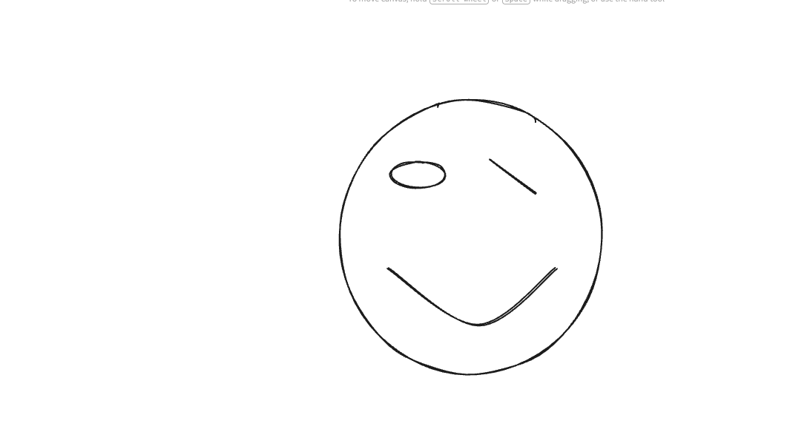

# Group Meeting Log Template (Sprint 1)

<!-- You should create one log per meeting. We expect to see at least 4 formal meetings. Create copies of this template for each meeting. -->
<!-- Logs should be in valid markdown. You can find a guide here: https://www.markdownguide.org/basic-syntax/ -->

> **Team Name / Group Number:**

---

## 1. Attendance

List all team members and mark **P** (present), **A** (absent), or **L** (late).

| Name | Role (if applicable) | Attendance |
| ---- | -------------------- | ---------- |
|Eloise      |                      |            |
|Freddie      |                      |            |
|Varat      |                      |            |
|Deeqa |  |  |
|Morley |  |  |
|Owen |  |  |
---

## 2. Meeting Purpose

<!-- A short sentence outlining why this meeting was held.

Examples:

- Refining user stories
- Agreeing design architecture
- Preparing for formative checkpoint
- Reviewing risks and assumptions
- Allocating tasks and deadlines -->

## 3. Agenda Items

List the planned discussion items.

1.
2.
3.

---

## 4. Discussion Summary

Concise notes capturing what was discussed, decisions made, alternatives considered.
Ensure you show evidence (e.g., screenshots, links to resources) of the discussion.

[Link to random notes](evidence/some_random_notes.md)

## 5. Decisions Made

Use bullet points for clarity. Include rationale where relevant.

- **Decision:**  
  **Reasoning:**
- **Decision:**  
  **Reasoning:**

## 6. Actions and Responsibilities

Clear, assigned tasks with deadlines.

| Task | Assigned To | Due Date | Status                               |
| ---- | ----------- | -------- | ------------------------------------ |
|      |             |          | Not started / In progress / Complete |
|      |             |          |                                      |
|      |             |          |                                      |

## 7. Next Meeting

**Proposed Date & Time:**

**Proposed Agenda Items:**
